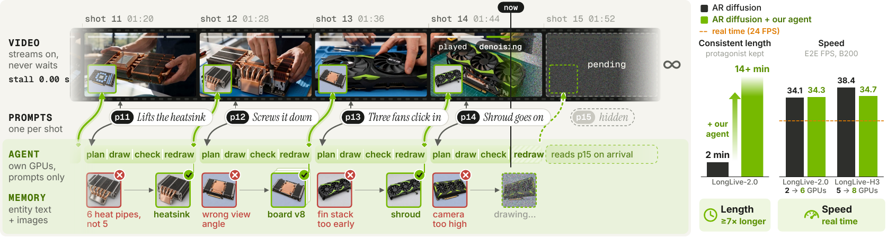
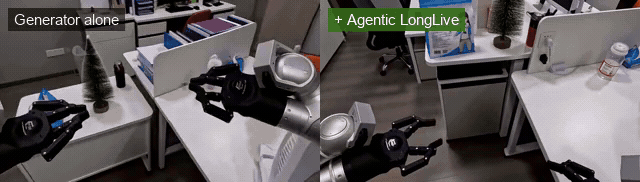
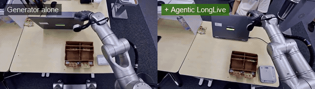
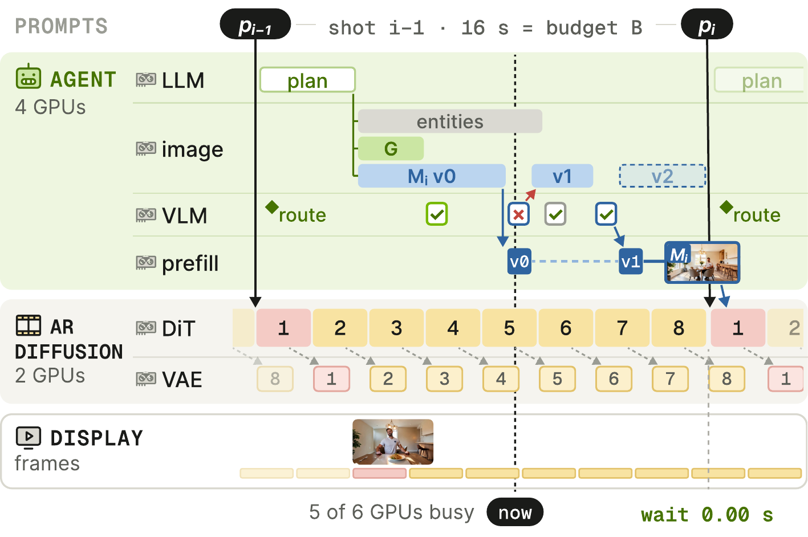

<!--
SPDX-FileCopyrightText: Copyright (c) 2026 NVIDIA CORPORATION & AFFILIATES. All rights reserved.
SPDX-License-Identifier: Apache-2.0
-->

<h1 align="center">Agentic LongLive: Asynchronous Agentic Memory for Long Video Generation</h1>

<p align="center">
  Shaoteng Liu<sup>3</sup>,
  Shuai Yang<sup>1</sup>,
  Wei Huang<sup>1</sup>,
  Luozhou Wang<sup>1</sup>,
  Song Han<sup>1,2</sup>,
  Yukang Chen<sup>1</sup>
</p>

<p align="center">
  <sup>1</sup>NVIDIA &nbsp;&nbsp;
  <sup>2</sup>MIT &nbsp;&nbsp;
  <sup>3</sup>CUHK
</p>

<p align="center">
  <a href="https://arxiv.org/abs/XXXX.XXXXX"></a>
  <a href="https://github.com/NVlabs/LongLive/tree/main/Agentic-LongLive"></a>
  <a href="https://nvlabs.github.io/LongLive/Agentic-LongLive/"></a>
  <a href="https://huggingface.co/Efficient-Large-Model"></a>
  <a href="#quick-start"></a>
  <a href="../LICENSE"></a>
</p>

<p align="center">
  <strong>A real-time video generator with a memory agent, running in parallel.</strong>
</p>

<p align="center">
  
</p>

Real-time autoregressive video generators stream minutes of video and take new prompts on the fly, but they forget
people, objects and places over a long interactive story. **Agentic LongLive** adds an asynchronous memory agent:

- the agent runs on its own GPUs, reads only the prompts revealed so far (never the generated video) and keeps a text
  state and evolving images for every person, object and place;
- from this entity memory it composes a global picture **G** and a per-shot picture **M**, which an auxiliary GPU
  prefills into the generator's attention sink before the next shot starts, and it writes entity cards for the prompts
  that name them, so **the video never waits for memory**;
- a small planner (Qwen3-8B + LoRA), trained with **reinforcement learning** and an image reward calibrated on
  downstream videos, decides what to remember before the next prompt is known.

On **LongStory-Online** (25 stories, 857 shots revealed one at a time) it improves LongLive-2.0's persistent-state
accuracy by 26.3 points, protagonist identity by 44.9 and revisited-place consistency by 40.4, at about 1% extra
generation time on H100, and it streams faster than real time on one 8×B200 node (34.3 FPS). The same agent plugs into
MiniMax-H3 generators (LongLive-H3, FastH3-Omni) and into robot video generation.

## Demos

Long stories generated live with FastH3-Omni and our memory agent (one prompt per 8 s shot; excerpts of every other
shot). Full videos and the agent's live log are on the [project page](https://nvlabs.github.io/LongLive/Agentic-LongLive/).

| Biscuit: a corgi shops and cooks a dinner | Plein Air: one canvas through five places |
| :---: | :---: |
| [](https://nvlabs.github.io/LongLive/Agentic-LongLive/) | [](https://nvlabs.github.io/LongLive/Agentic-LongLive/) |
| **Spare Parts: a brick figure builds a car** | **Exposure: a fox photo from dawn to darkroom** |
| [](https://nvlabs.github.io/LongLive/Agentic-LongLive/) | [](https://nvlabs.github.io/LongLive/Agentic-LongLive/) |

Robotics: one first frame and eight instructions, rendered as one continuous 64 s video. Things leave the view and come
back; the agent pins screenshots of how they looked (left: the generator alone, right: with our agent).

| Fan turned away and back | Card hidden and found again |
| :---: | :---: |
|  |  |

## Contents

- [Overview](#overview)
- [Checkpoints](#checkpoints)
- [Quick start](#quick-start)
- [Inference: long stories](#inference-long-stories)
- [Benchmark: LongStory-Online](#benchmark-longstory-online)
- [Robotics](#robotics)
- [Training the RL memory planner](#training-the-rl-memory-planner)
- [Ablation switches](#ablation-switches)
- [Repository layout](#repository-layout)
- [Citation](#citation)

## Overview

<p align="center">
  
</p>

While shot *i−1* streams, the agent plans the update for prompt *p<sub>i−1</sub>*, draws the changed entities and the
memory pictures G and M<sub>i</sub>, checks them with a VLM and commits each version as soon as it is ready; the
auxiliary GPU prefills the committed version into the attention sink. When *p<sub>i</sub>* arrives, the only model
call on the critical path is **scene routing** (keep the current place, recall an earlier one, or start a new one), and
shot *i* starts from the newest prefilled memory. Every component is described in the paper; the code follows the same
names (`agentic_longlive/agent`, `memory`, `runtime`, `backends`).

| Component | Model (default) | Where |
| --- | --- | --- |
| Memory planner | Qwen3-8B + GRPO LoRA (RL), EAGLE-3 decoding | `agent/policy.py`, `agent/prompts.py`, `rl/` |
| Checker + scene router | Qwen3.6-35B-A3B (FP8) | `agent/painter.py`, `agent/router.py` |
| Memory pictures | FLUX.2-klein-4B (4 steps) | `agent/painter.py` |
| Generator | LongLive-2.0 (in process) · LongLive-H3 · FastH3-Omni (worker queue) | `backends/`, `workers/` |

## Checkpoints

| What | Hugging Face | Size | Used by |
| --- | --- | ---: | --- |
| LongLive-2.0 generator | [Efficient-Large-Model/LongLive-2.0-5B](https://huggingface.co/Efficient-Large-Model/LongLive-2.0-5B) (`model_bf16.pt`) | 9.4 GB | LongLive-2.0 backend |
| Wan2.2 text encoder + VAE | [Wan-AI/Wan2.2-TI2V-5B](https://huggingface.co/Wan-AI/Wan2.2-TI2V-5B) | 32 GB | LongLive-2.0 backend |
| **RL memory planner** (Qwen3-8B + LoRA, merged) | `Efficient-Large-Model/Agentic-LongLive-Planner-Qwen3-8B` — **coming soon** | 16 GB | agent |
| EAGLE-3 draft for the planner | [Tengyunw/qwen3_8b_eagle3](https://huggingface.co/Tengyunw/qwen3_8b_eagle3) | 0.8 GB | agent (speed only) |
| Checker / scene router | [Qwen/Qwen3.6-35B-A3B-FP8](https://huggingface.co/Qwen/Qwen3.6-35B-A3B-FP8) | 37 GB | agent |
| Memory pictures | [black-forest-labs/FLUX.2-klein-4B](https://huggingface.co/black-forest-labs/FLUX.2-klein-4B) | 16 GB | agent |
| LongLive-H3 (optional) | `Efficient-Large-Model/LongLive-H3` — **coming soon** + [MiniMaxAI/MiniMax-H3](https://huggingface.co/MiniMaxAI/MiniMax-H3) | 62 GB + base | H3 worker |
| G foreground masks (optional) | [ZhengPeng7/BiRefNet](https://huggingface.co/ZhengPeng7/BiRefNet) (downloaded on first use) | 0.4 GB | LongLive-H3 backend |
| FastH3-Omni (optional) | [FastVideo/FastVideo-FastH3-Omni-8-Step-V1](https://huggingface.co/FastVideo/FastVideo-FastH3-Omni-8-Step-V1) | — | FastH3 worker |
| LongStory-Online | in this repository: [`stories/longstory_online/`](stories/longstory_online) (+ `full/` control prompts) | 9 MB | benchmark |

Until the RL planner is released, run the agent with the frozen Qwen3.6 planner
(`--ablation configs/ablations/no_rl_planner.yaml`), or train it yourself ([below](#training-the-rl-memory-planner)).

## Quick start

```bash
git clone --filter=blob:none --sparse https://github.com/NVlabs/LongLive.git
cd LongLive && git sparse-checkout set Agentic-LongLive LongLive2.0
cd Agentic-LongLive

# LongLive-2.0 environment (Python 3.10, PyTorch 2.8 + CUDA 12.8), then this project's few extra packages
conda create -n agentic-longlive python=3.10 -y && conda activate agentic-longlive
pip install torch==2.8.0 torchvision==0.23.0 --index-url https://download.pytorch.org/whl/cu128
pip install flash-attn==2.8.3 --no-build-isolation
pip install -r ../LongLive2.0/requirements.txt -r requirements.txt
pip install "sglang>=0.5"        # agent model servers (a separate environment works too)

bash scripts/download_weights.sh  # into checkpoints/

# CPU dry run of the whole runtime with stand-in models
python scripts/run_story.py --config configs/mock.yaml
```

## Inference: long stories

The memory agent is the same for every generator; only the generator and its config change. The agent's three model
servers (`scripts/serve_agent.sh`: planner, checker + scene router, FLUX.2-klein) take one 80 GB GPU each.

| Generator | Runs as | GPUs for the generator | Speed | Config |
| --- | --- | --- | --- | --- |
| LongLive-2.0 | in process | 3 (generator, memory prefill, VAE decode) | 10.5 s shot in ~16 s on H100 | `configs/longlive.yaml` |
| FastH3-Omni | UniServe server + worker (own environment) | 8, Hopper or Blackwell | 8 s shot in ~6.6 s on 8×B200 (FP8): real time; ~13.5 s on 8×H100 (BF16) | `configs/fasth3.yaml` |
| LongLive-H3 | worker (own environment) | 1 per worker + 1 shared text encoder | reference implementation, not real time | `configs/longlive_h3.yaml` |

Each run directory holds `video.mp4`, one MP4 per shot, the memory the agent committed (`memory/`: entity images, G, M,
entity stores) and `trace.jsonl` with every agent decision. `summary.json` reports speed and the memory lag per shot.
Write your own story as a JSON file with a cast and one prompt per shot (see `stories/longstory_online/README.md`);
prompts are revealed to the agent one at a time, exactly as in a live session. The stories of the demos above are in
[`stories/demo/`](stories/demo); they also carry the MiniMax-H3 prompt format that both H3 generators use.

### LongLive-2.0

The full system uses 6 GPUs with 80 GB each: generator, memory prefill and VAE decode on GPUs 0–2, the agent servers on
GPUs 3–5. The memory-prefill GPU holds a second copy of the generator and the memory K/V (up to about 60 GB), so do not
share it with other processes. A100 80 GB also works, at about 37 s per shot; the A100 agent servers are in the header of
`scripts/serve_agent.sh`.

```bash
bash scripts/serve_agent.sh       # planner :30000, checker + router :31001, FLUX.2-klein :32001 (GPUs 3-5)
python scripts/run_story.py --config configs/longlive.yaml \
    --story stories/longstory_online/collie_muddy_day.json output_dir=outputs/collie
bash scripts/serve_agent.sh stop  # stop the agent servers
```

### FastH3-Omni (the demos above)

FastH3-Omni generates each 8 s shot at once in 8 steps, with stereo audio. The UniServe server (patched for the memory
sink) holds all 8 GPUs of a node, and a worker passes it the agent's jobs through a file queue. The client
(`run_story.py`) needs no GPU and runs on the same node. Put the agent servers on 3 GPUs of a second node and forward
their ports. Setup needs UniServe's system packages (see the header of `scripts/workers/setup_fasth3.sh`) and the
accepted MiniMax-H3 license on Hugging Face.

```bash
# once: UniServe at the pinned commit + the sink patch + FastH3-Omni weights, in their own environment
# (CUDA_HOME must hold a CUDA 13 toolkit; without one, INSTALL_CUDA=1 installs it under FH_ROOT)
FH_ROOT=/data/fasth3 CUDA_HOME=/usr/local/cuda-13.0 bash scripts/workers/setup_fasth3.sh

# server on GPUs 0-7 + worker. PRESET: b200-realtime (8×B200, FP8, the paper's real-time setting),
# 80gb (8×H100, BF16) or default (8×H200 class, BF16)
FH_ROOT=/data/fasth3 PRESET=b200-realtime bash scripts/workers/serve_fasth3.sh

# agent servers: on a second node, inside Agentic-LongLive/, run `bash scripts/serve_agent.sh` (GPUs 3-5 there),
# then forward their ports to this node
ssh -N -L 30000:127.0.0.1:30000 -L 31001:127.0.0.1:31001 -L 32001:127.0.0.1:32001 agent-node &

# a demo story, one prompt every 8 s
AGL_H3_QUEUE=/data/fasth3/queue python scripts/run_story.py --config configs/fasth3.yaml \
    --story stories/demo/biscuit.json output_dir=outputs/biscuit_fasth3

FH_ROOT=/data/fasth3 bash scripts/workers/serve_fasth3.sh stop   # also: status
```

Presets, the sink patch and running the worker by hand: [docs/generators.md](docs/generators.md#fasth3-omni).

### LongLive-H3

LongLive-H3 is our few-step chunked autoregressive distillation of MiniMax-H3, with video and audio. Its weights are
coming soon. The released worker is the exact reference sampler: one shot per GPU, not real time.

```bash
H3_ROOT=/data/longlive_h3 bash scripts/workers/setup_longlive_h3.sh              # once: environment + weights
H3_ROOT=/data/longlive_h3 TE_GPU=0 GPUS="1" bash scripts/workers/serve_longlive_h3.sh   # text encoder + 1 worker
bash scripts/serve_agent.sh                                                       # agent servers on GPUs 3-5
AGL_H3_QUEUE=/data/longlive_h3/queue python scripts/run_story.py --config configs/longlive_h3.yaml \
    --story stories/demo/biscuit.json output_dir=outputs/biscuit_longlive_h3
```

More workers, queue modes and G masks: [docs/generators.md](docs/generators.md#longlive-h3).

## Benchmark: LongStory-Online

25 stories (9 hand-written, 16 LongStory-Hard), 857 terse shot prompts revealed one at a time, with hidden per-shot
annotations used only for scoring. A VLM judge scores persistent state, identity, same protagonist, location and
revisits; see [docs/benchmark.md](docs/benchmark.md).

```bash
for s in stories/longstory_online/*.json; do
  python scripts/run_story.py --config configs/longlive.yaml --story $s output_dir=outputs/bench/$(basename $s .json)
done
python scripts/evaluate.py --runs outputs/bench --stories stories/longstory_online --judge gemini
```

| LongStory-Online (LongLive-2.0, 3 seeds) | State | Identity | Same prot. | Location | Revisit | Time / shot (H100) |
| --- | ---: | ---: | ---: | ---: | ---: | ---: |
| LongLive-2.0 (built-in memory) | 38.2 | 44.1 | 18.1 | 68.8 | 15.0 | 15.8 s |
| **Agentic LongLive (full system)** | **64.5** | **89.0** | **46.8** | **98.0** | **55.4** | 16.0 s (+0.9%) |

## Robotics

The same agent keeps a robot's workspace consistent over a long continuous video: an observer reads finished segments
and keeps a ledger of places, objects and containers, and when something comes back into view it pins screenshots of how
it last looked. With FastH3-Omni, the returning object comes back with the same identity and position at 56% of return
moments instead of 20%, in real time. The first frames come from the RoVid-X validation set and are not redistributed:
[stories/robot/README.md](stories/robot/README.md) lists them. See [docs/robotics.md](docs/robotics.md).

```bash
FH_ROOT=/data/fasth3 bash scripts/workers/serve_fasth3.sh   # FastH3-Omni server + worker (keyframe continuation)
python scripts/run_robot.py --episode stories/robot/15_turn_fan_knob.json --image-root data/robot_first_frames \
    --queue /data/fasth3/queue --agent-url http://127.0.0.1:31001/v1 --arm both --policy v4 --out outputs/robot/fan
```

## Training the RL memory planner

Teacher rollouts, an SFT warm start on the best of four, then GRPO with the v4 reward (text belief + image reward
calibrated on downstream videos). Each seed trains on one H100; rollout, judge and image servers are shared. Details,
data layout and the training data download are in [docs/rl.md](docs/rl.md).

```bash
hf download Efficient-Large-Model/Agentic-LongLive-RL-Data --repo-type dataset --local-dir data/rl   # coming soon
bash scripts/rl/serve.sh           # judge / teacher (Qwen3.6), rollout server (Qwen3-8B + LoRA), FLUX.2-klein
bash scripts/rl/collect.sh         # teacher rollouts -> data/rl/rollouts, best of 4 -> data/rl/sft/bestof.jsonl
bash scripts/rl/sft.sh             # SFT warm start -> outputs/rl/sft
bash scripts/rl/grpo.sh            # GRPO, 80 steps -> outputs/rl/grpo_s0 (SEED=1, 2 for more seeds)
bash scripts/rl/serve_planner.sh   # merge the adapter and serve it as the agent's planner
```

## Ablation switches

Every switch lives in `agentic_longlive/config.py` with a comment; the defaults are the full system. Overlays in
`configs/ablations/` apply them with `--ablation configs/ablations/<name>.yaml`; single values can be overridden as
`key=value` on the command line.

| Overlay | Switch | What changes |
| --- | --- | --- |
| `no_memory` | `memory.mode=none` | the generator alone (LongLive-2.0: its built-in multi-shot memory) |
| `no_rl_planner` | `agent.planner` | the frozen Qwen3.6-35B-A3B writes the memory updates |
| `no_routing` | `backend.params.scene_routing=none` | every shot starts from [G, M<sub>i−2</sub>, M<sub>i−1</sub>] |
| `no_cards` | `runtime.entity_cards=false` | memory enters only as pictures |
| `scene_g` | `agent.neutral_g=false` | G is drawn inside a scene instead of on a neutral backdrop |
| `no_global` / `one_m_slot` | `memory.use_g` / `memory.m_slots` | drop G / keep one M |
| `text_memory` | `memory.mode=text` | G and M drawn straight from the prompt history, no entity layer |
| `no_check` / `refine_r1` / `gate_first_round` | `agent.*` | no image checks / one round per update / stricter commit rule |
| `policy_recent` / `policy_frequency` | `agent.policy` | rule-based instead of learned member selection |
| `sync_agent` / `lag_plus1` / `no_aux_prefill` | `runtime.*` | the video waits for memory / older memory / prefill on the generator GPU |
| `read_video` | `agent.read_generated_video=true` | closed loop: the agent also reads generated frames |
| `oracle_next_prompt` | `agent.oracle_next_prompt=true` | upper bound that breaks the online protocol |

Other generator switches (`backends/longlive.py` docstring): `attn_backend` (fa2 / fa4 / cudnn kernels),
`async_decode_tail` (start the next shot while the last blocks decode), `recall_prefill`, `route_llm_style` (SGLang or
vLLM constrained decoding). `runtime.replay_memory=<run_dir>` re-injects the memory stream of an earlier run without the
agent, so generator-side ablations share one memory stream.

## Repository layout

```
Agentic-LongLive/
├── agentic_longlive/
│   ├── agent/        memory agent: planner prompts, member policy, painter (draw + check), scene router
│   ├── memory/       entity store, state updates, snapshots (G / M versions), entity cards
│   ├── runtime/      live session: prompt stream, asynchronous agent, prefill worker, trace
│   ├── backends/     LongLive-2.0 (in process), MiniMax-H3 client, CPU mock
│   ├── workers/      LongLive-H3 and FastH3-Omni workers + file-queue protocol
│   ├── models/       LLM / VLM / image providers (OpenAI-compatible servers, Gemini, OpenAI images)
│   ├── rl/           RL planner: rollouts, rewards, SFT / GRPO, merge
│   ├── robotics/     robot agent (observer, router, planner) and the real-time segment loop
│   └── eval/         LongStory-Online judge and metrics
├── configs/          full-system configs, agents/, backends/, ablations/, rl/
├── stories/          longstory_online/ benchmark, robot/ episodes
├── scripts/          run_story.py, evaluate.py, run_robot.py, serve_agent.sh, download_weights.sh, rl/, workers/
├── docs/             generators.md, benchmark.md, robotics.md, rl.md
└── tests/            CPU tests (pytest tests/)
```

## Citation

```bibtex
@article{liu2026agenticlonglive,
  title   = {Agentic LongLive: Asynchronous Agentic Memory for Long Video Generation},
  author  = {Liu, Shaoteng and Yang, Shuai and Huang, Wei and Wang, Luozhou and Han, Song and Chen, Yukang},
  journal = {arXiv preprint},
  year    = {2026}
}
```

## Acknowledgements

Agentic LongLive builds on [LongLive-2.0](../LongLive2.0) and [Wan2.2](https://github.com/Wan-Video/Wan2.2). The agent
uses [Qwen3](https://github.com/QwenLM/Qwen3) and [FLUX.2](https://github.com/black-forest-labs/flux2) served with
[SGLang](https://github.com/sgl-project/sglang); the H3 generators build on [MiniMax-H3](https://huggingface.co/MiniMaxAI/MiniMax-H3),
[FastVideo](https://github.com/hao-ai-lab/FastVideo) and [UniServe](https://github.com/hao-ai-lab/uniserve). The robot
first frames come from the RoVid-X validation set (not redistributed here).
