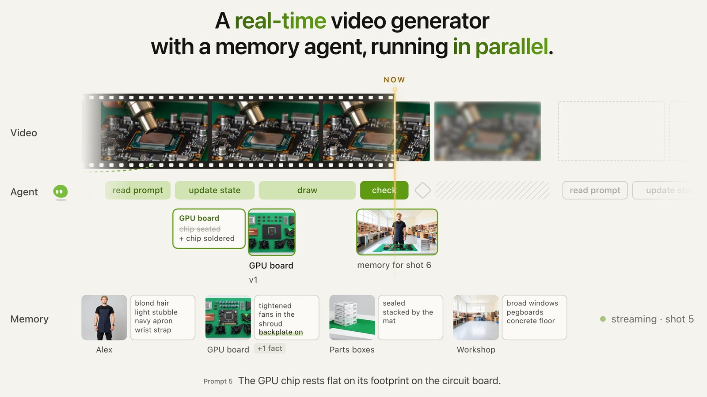
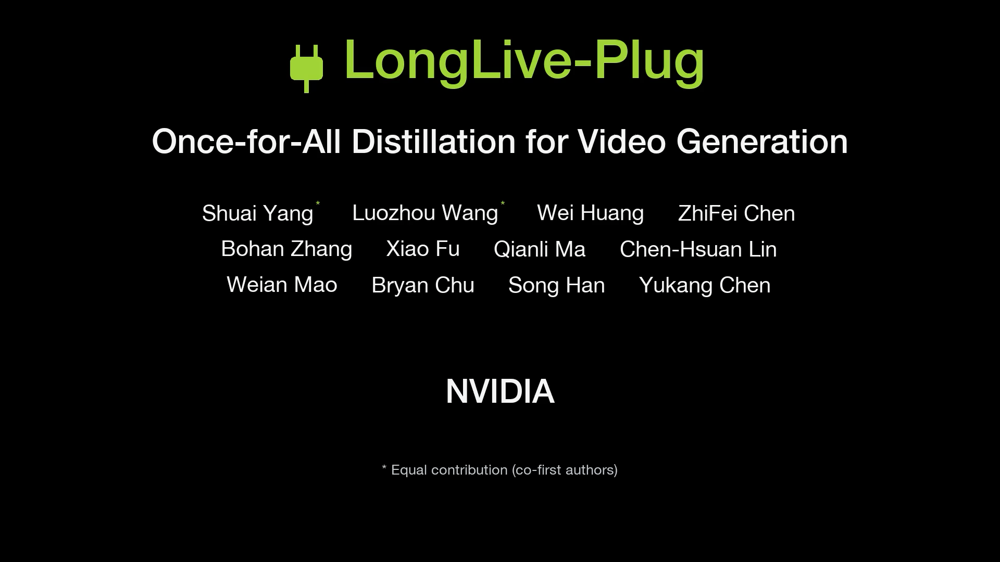
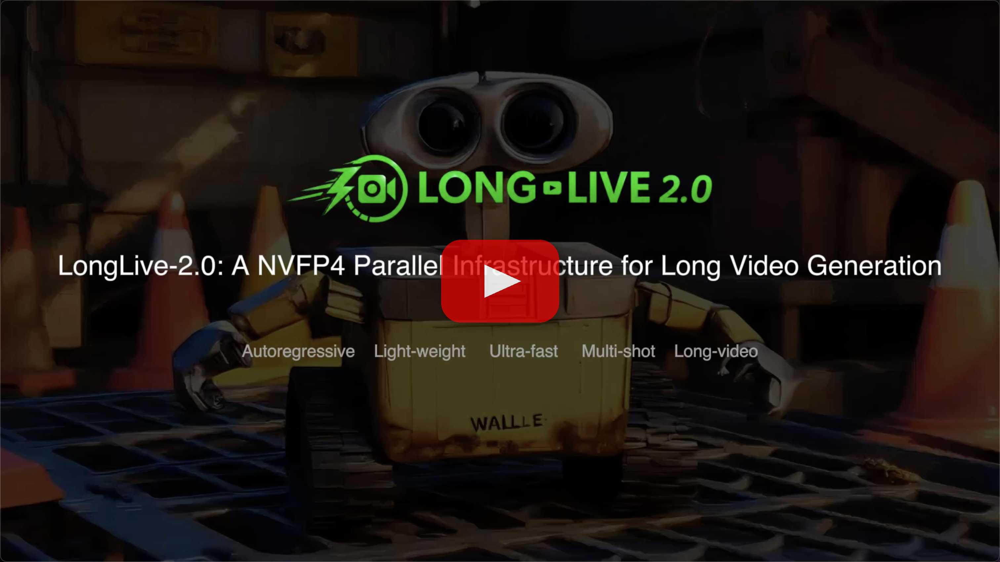
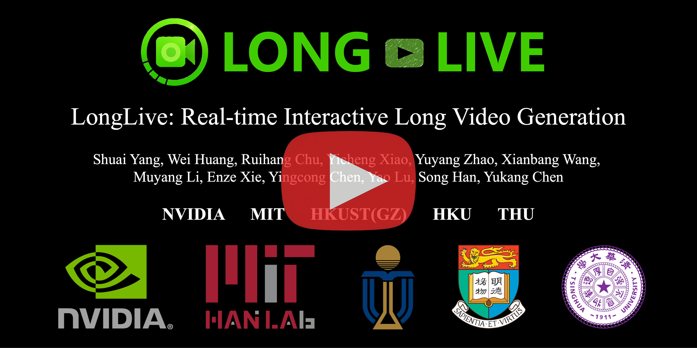
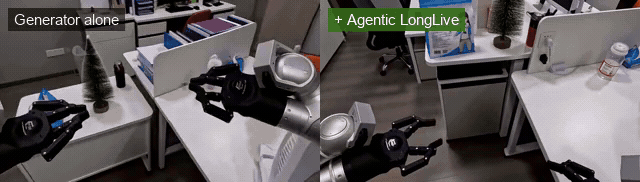
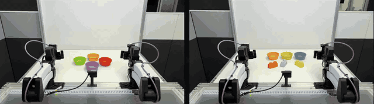
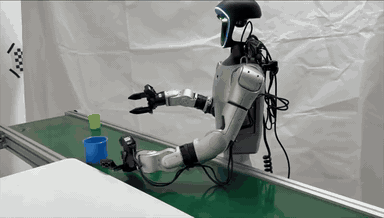
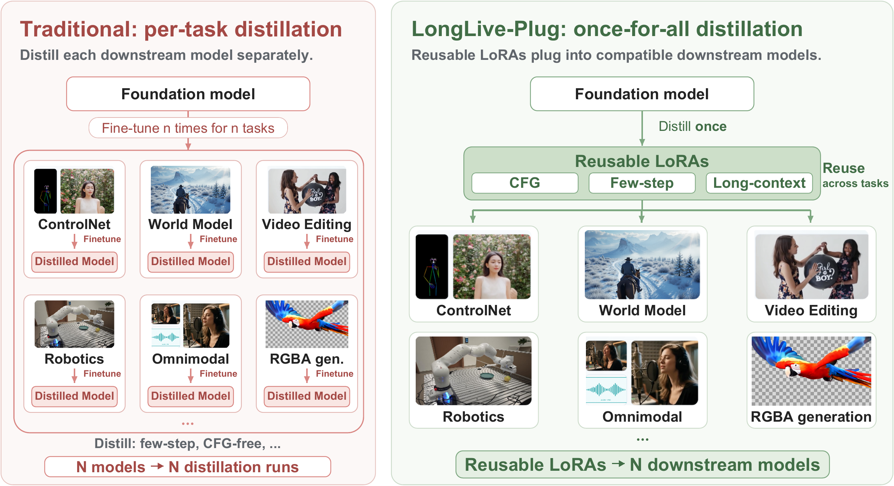
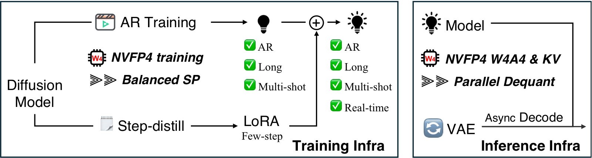
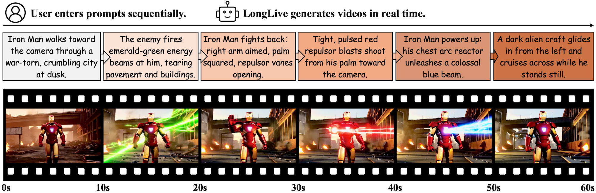

<!--
SPDX-FileCopyrightText: Copyright (c) 2026 NVIDIA CORPORATION & AFFILIATES. All rights reserved.
SPDX-License-Identifier: Apache-2.0
Provenance: Modified from NVlabs/LongLive.
Source: https://github.com/NVlabs/LongLive @ fb16a87 :: README.md
Changes: Add the independent Long-WAM and Agentic LongLive projects and group the overview by project.
-->

<p align="center">
  
  
</p>

<h2 align="center">LongLive Family</h2>

<p align="center">
  <b>Agentic, Robotic, Transferable, Infra-native, Interactive Long Video Gen</b>
</p>

<p align="center">
  <a href="Agentic-LongLive"></a>
  <a href="https://arxiv.org/abs/2610.10528"></a>
  <a href="https://arxiv.org/abs/2609.38154"></a>
  <a href="https://arxiv.org/abs/2605.18739"></a>
  <a href="https://arxiv.org/abs/2509.22622"></a>
  <br>
  <a href="https://nvlabs.github.io/LongLive/Agentic-LongLive/"></a>
  <a href="https://nvlabs.github.io/LongLive/Long-WAM/"></a>
  <a href="https://nvlabs.github.io/LongLive/LongLive-Plug/"></a>
  <a href="https://nvlabs.github.io/LongLive/LongLive2/"></a>
  <a href="https://nvlabs.github.io/LongLive/LongLive1/"></a>
</p>

## Projects

<table>
<tr>
<td width="40%" align="center">
  <a href="https://www.youtube.com/watch?v=czP61EBbaa4"></a>
</td>
<td width="60%">
  <a href="Agentic-LongLive"><b>Agentic LongLive</b></a><br>
  Asynchronous agentic memory for long video generation.<br>
  <sub>Keep people, objects and places consistent over long interactive stories and robot videos, with an LLM memory agent running beside a real-time generator.</sub><br>
  <sub><a href="Agentic-LongLive">Code</a> · <a href="https://nvlabs.github.io/LongLive/Agentic-LongLive/">Project page</a> · <a href="https://www.youtube.com/watch?v=czP61EBbaa4">Video</a></sub>
</td>
</tr>
<tr>
<td width="40%" align="center">
  <a href="https://www.youtube.com/watch?v=sQGoMf6au1Y"></a>
</td>
<td width="60%">
  <a href="Long-WAM"><b>Long-WAM</b></a><br>
  Long-context world-action models.<br>
  <sub>Train and evaluate robot policies, generate robot videos, or deploy on YAM, Franka and Unitree G1.</sub><br>
  <sub><a href="https://arxiv.org/abs/2610.10528">Paper</a> · <a href="Long-WAM">Code</a> · <a href="https://nvlabs.github.io/LongLive/Long-WAM/">Project page</a> · <a href="https://www.youtube.com/watch?v=sQGoMf6au1Y">Video</a></sub>
</td>
</tr>
<tr>
<td width="40%" align="center">
  <a href="https://youtu.be/pXNrJvBZvZU"></a>
</td>
<td width="60%">
  <a href="LongLive-Plug"><b>LongLive-Plug</b></a><br>
  Once-for-all distillation for video generation.<br>
  <sub>Distill a capability once on a base model and reuse it across downstream models, without retraining.</sub><br>
  <sub><a href="https://arxiv.org/abs/2609.38154">Paper</a> · <a href="LongLive-Plug">Code</a> · <a href="https://nvlabs.github.io/LongLive/LongLive-Plug/">Project page</a> · <a href="https://youtu.be/pXNrJvBZvZU">Video</a></sub>
</td>
</tr>
<tr>
<td width="40%" align="center">
  <a href="https://www.youtube.com/watch?v=7oQALy32fiU"></a>
</td>
<td width="60%">
  <a href="LongLive2.0"><b>LongLive 2.0</b></a><br>
  An NVFP4 parallel infrastructure for long video generation.<br>
  <sub>Train or serve long-video models fast, with NVFP4 quantization and sequence parallelism.</sub><br>
  <sub><a href="https://arxiv.org/abs/2605.18739">Paper</a> · <a href="LongLive2.0">Code</a> · <a href="https://nvlabs.github.io/LongLive/LongLive2/">Project page</a> · <a href="https://www.youtube.com/watch?v=7oQALy32fiU">Video</a></sub>
</td>
</tr>
<tr>
<td width="40%" align="center">
  <a href="https://www.youtube.com/watch?v=CO1QC7BNvig"></a>
</td>
<td width="60%">
  <a href="LongLive1.0"><b>LongLive 1.0</b></a><br>
  Real-time interactive long video generation.<br>
  <sub>Type prompts and watch a long video appear in real time, steered as you go.</sub><br>
  <sub><a href="https://arxiv.org/abs/2509.22622">Paper</a> · <a href="LongLive1.0">Code</a> · <a href="https://nvlabs.github.io/LongLive/LongLive1/">Project page</a> · <a href="https://www.youtube.com/watch?v=CO1QC7BNvig">Video</a></sub>
</td>
</tr>
</table>

<p align="center"><sub>Click a thumbnail to watch the overview video on YouTube.</sub></p>

## Download one project

Each project is self-contained. Download only the project you need using partial
clone and sparse checkout; the example below selects **Long-WAM**.

```bash
git clone --filter=blob:none --sparse --single-branch --branch main --depth 1 https://github.com/NVlabs/LongLive.git
cd LongLive
git sparse-checkout set Long-WAM
cd Long-WAM
```

For another project, replace `Long-WAM` in the last two commands with
`Agentic-LongLive`, `LongLive-Plug`, `LongLive2.0` or `LongLive1.0`. Only the selected project and
shared root files are downloaded; no other project is required to run it, except that
Agentic LongLive runs its LongLive-2.0 generator from `LongLive2.0/`
(`git sparse-checkout set Agentic-LongLive LongLive2.0`).

## News

- 🔥 [2026.11.24] We release **Agentic LongLive**: an asynchronous LLM memory agent for real-time long video generation, with the full system on LongLive-2.0 and MiniMax-H3 generators, the LongStory-Online benchmark, robot-video memory and RL training of the memory planner. → [`Agentic-LongLive/`](Agentic-LongLive) · [Project page](https://nvlabs.github.io/LongLive/Agentic-LongLive/)
- 🔥 [2026.10.08] The [Long-WAM paper](https://arxiv.org/abs/2610.10528) is available on arXiv.
- 🔥 [2026.10.07] We release **Long-WAM**: long-context world-action models, robot-video pretraining, benchmark training/evaluation and real-robot deployment demos. → [`Long-WAM/`](Long-WAM) · [Project page](https://nvlabs.github.io/LongLive/Long-WAM/)
- 🔥 [2026.09.28] We release **LongLive-Plug** training and inference code with four recipes covering CFG and few-step distillation. → [`LongLive-Plug/`](LongLive-Plug)
- 🔥 [2026.07.08] LongLive 2.0 supports FP8 inference. Please refer to [here](LongLive2.0/README.md#fp8-ptq).

<details>
<summary>Earlier news</summary>

- 🔥 [2026.06.01] We released [LongLive-RAG](https://github.com/qixinhu11/LongLive-RAG), a general retrieval-augmented framework for long video gen.
- 🔥 [2026.05.30] LongLive 2.0 now supports I2V AR teacher-forcing training and I2V DMD distillation for Wan2.2-TI2V-5B.
- ⚡ [2026.05.25] We optimized the NVFP4 inference path with fused Triton RoPE/adaLN kernels, reduced KV-cache synchronization overhead, in-place quantized KV-cache updates, faster FP4 KV dequantization, pinned VAE transfers, and safer LoRA-before-quantization setup, improving overall throughput by **18.6%**.
- 🔥 [2026.05.13] We release **LongLive 2.0**, infra with NVFP4, parallelism and multi-shot for AR training, DMD distillation, and inference (⚡45.7 FPS).
- 🔥 [2026.04.12] LongLive supports kv cache compression with [TriAttention](https://github.com/WeianMao/triattention), with 50% KV reduction and no quality drop. Check it [here](https://github.com/WeianMao/triattention/tree/main/longlive)
- 🎉 [2026.01.27] LongLive is accepted by **ICLR-2026**.
- 🔥 [2026.01.11] LongLive supports adapting LongLive's original RoPE into KV-cache relative RoPE and generates infinite long videos!
- 🔥 [2025.11.03] We implement LongLive on linear attention model [SANA-Video](https://nvlabs.github.io/Sana/Video/)! Now SANA-Video can generate 60s interactive videos in real-time.
- 🔥 [2025.09.29] We release [Paper](https://arxiv.org/abs/2509.22622), this GitHub repo [LongLive](https://github.com/NVlabs/LongLive) with all training and inference code, the model weight [LongLive-1.3B](https://huggingface.co/Efficient-Large-Model/LongLive-1.3B), and demo page [Website](https://nvlabs.github.io/LongLive/LongLive1/).

</details>

## Agentic LongLive — Asynchronous Agentic Memory for Long Video Generation

**A real-time video generator with a memory agent, running in parallel.** A memory agent on its own GPUs reads the
prompts as they arrive, keeps text and images for every person, object and place, and writes memory pictures into the
generator's attention sink before each shot, so the video never waits. A small planner trained with RL decides what to
remember.

<table>
<tr>
<td width="25%" align="center"><h3>⏱️ 14 min+</h3><sub>stories that keep the same people and image quality; LongLive-2.0 alone loses identity after 2 min</sub></td>
<td width="25%" align="center"><h3>🎯 ≈0 drift</h3><sub>image quality, last minute vs. first: +0.002, vs. −0.089 for LongLive-2.0 alone</sub></td>
<td width="25%" align="center"><h3>⚡ 34.3 FPS</h3><sub>full system on one 8×B200 node (BF16), 1.43× faster than real time</sub></td>
<td width="25%" align="center"><h3>👍 98.8%</h3><sub>user votes for our persistent state vs. LongLive-2.0's built-in memory</sub></td>
</tr>
</table>

- **Results:** on LongStory-Online (25 stories, 857 shots, about 150 minutes of video) it raises LongLive-2.0's
  persistent-state accuracy by 26.3 points, identity by 44.9 and revisit consistency by 40.4.
- **No drift over long stories:** LongLive-2.0 alone forgets the protagonist after about two minutes and its image
  quality decays over the story. With the agent, identity and image quality stay flat through 14-minute stories.
- **Memory costs almost nothing:** the agent runs on its own GPUs and adds about 1% generation time (H100).
  LongLive-H3 with the agent also streams in real time (34.7 FPS, 1.45×, optimized kernels).
- **Generators:** LongLive-2.0, LongLive-H3 and FastH3-Omni; robot videos with screenshot memory.
- **Release:** full system with documented ablation switches, LongStory-Online benchmark and judge, RL training.

| Live story (FastH3-Omni) | Robot video: generator alone vs. with our agent |
| --- | --- |
| [](https://nvlabs.github.io/LongLive/Agentic-LongLive/) | [](https://nvlabs.github.io/LongLive/Agentic-LongLive/) |

### Checkpoints

The full system runs on public generators, [LongLive-2.0-5B](https://huggingface.co/Efficient-Large-Model/LongLive-2.0-5B)
and [FastH3-Omni](https://huggingface.co/FastVideo/FastVideo-FastH3-Omni-8-Step-V1) (a few-step distillation of
[MiniMax-H3](https://huggingface.co/MiniMaxAI/MiniMax-H3) released by FastVideo), and on open agent models
(Qwen3.6-35B-A3B, FLUX.2-klein-4B). See [checkpoints](Agentic-LongLive/README.md#checkpoints).

| Model | Use |
| --- | --- |
| [LongLive-2.0-5B](https://huggingface.co/Efficient-Large-Model/LongLive-2.0-5B) | Real-time AR generator of the main LongStory-Online results |
| [FastH3-Omni](https://huggingface.co/FastVideo/FastVideo-FastH3-Omni-8-Step-V1) | Few-step MiniMax-H3 generator with audio, used for the live demos |
| [LongLive-H3](https://huggingface.co/Andyson/LongLive-H3) | Few-step chunked-AR MiniMax-H3 generator used with the agent |
| Agentic-LongLive-Planner-Qwen3-8B (coming soon) | RL memory planner (Qwen3-8B + GRPO LoRA, merged) |

→ [Code and quick start](Agentic-LongLive) · [Checkpoints](Agentic-LongLive/README.md#checkpoints) ·
[Project page](https://nvlabs.github.io/LongLive/Agentic-LongLive/)

## Long-WAM — Scaling the Context of World-Action Models

Long-context robot policies with streaming visual memory, built on LongLive 2.0
Robot video pretraining.

- **Benchmarks:** LIBERO, RoboTwin 2.0, Domino, RoboCasa GR1 and RoboCasa365.
- **Inference:** streaming IDM/COD, configurable Agentic API and image-to-video demos.
- **Deployment:** RTX 5090, DGX Spark and AGX Thor runtime profiles; YAM, Franka and Unitree G1 interfaces.

| Generated robot video | YAM long-horizon task | Unitree G1 cup stacking |
| --- | --- | --- |
| [](https://nvlabs.github.io/LongLive/Long-WAM/#demos) | [](https://nvlabs.github.io/LongLive/Long-WAM/#demos) | [](https://nvlabs.github.io/LongLive/Long-WAM/#demos) |

### Checkpoints

Public checkpoints on [Efficient-Large-Model](https://huggingface.co/Efficient-Large-Model).
See [download and inference instructions](Long-WAM/README.md#checkpoints).

| Model family | Released variants | Use |
| --- | --- | --- |
| Long-WAM LIBERO | [IDM](https://huggingface.co/Efficient-Large-Model/Long-WAM-LIBERO-IDM) · [COD](https://huggingface.co/Efficient-Large-Model/Long-WAM-LIBERO-COD) | LIBERO policy inference |
| Long-WAM RoboTwin 2.0 | [IDM](https://huggingface.co/Efficient-Large-Model/Long-WAM-RoboTwin2.0-IDM) · [COD](https://huggingface.co/Efficient-Large-Model/Long-WAM-RoboTwin2.0-COD) | RoboTwin 2.0 policy inference |
| Long-WAM RoboCasa GR1 | [0 s](https://huggingface.co/Efficient-Large-Model/Long-WAM-RoboCasa-GR1-0s) · [2.4 s](https://huggingface.co/Efficient-Large-Model/Long-WAM-RoboCasa-GR1-2.4s) · [4.8 s](https://huggingface.co/Efficient-Large-Model/Long-WAM-RoboCasa-GR1-4.8s) · [9.6 s](https://huggingface.co/Efficient-Large-Model/Long-WAM-RoboCasa-GR1-9.6s) | Context-length scaling; 19.2 s under investigation, updated checkpoint coming soon. |
| Long-WAM RoboCasa365 | [RoboCasa365](https://huggingface.co/Efficient-Large-Model/Long-WAM-RoboCasa365) | Generalist kitchen policy |
| Long-WAM YAM | [YAM](https://huggingface.co/Efficient-Large-Model/Long-WAM-YAM) | Bimanual pretraining on ABC 130K |
| LongLive 2.0 Robot | [Robot-S](https://huggingface.co/Efficient-Large-Model/LongLive2.0-Robot-S) · [Robot-M](https://huggingface.co/Efficient-Large-Model/LongLive2.0-Robot-M) | Autoregressive robot-video generation |

→ [Paper](https://arxiv.org/abs/2610.10528) · [Code and quick start](Long-WAM) · [Checkpoints](Long-WAM/README.md#checkpoints) ·
[Project page](https://nvlabs.github.io/LongLive/Long-WAM/) ·
[Video](https://www.youtube.com/watch?v=sQGoMf6au1Y)

## LongLive-Plug — Once-for-All Distillation for Video Generation

Separates reusable capabilities from task-specific customization: train
functional LoRAs on a base model, then attach them to compatible downstream
models while keeping those models' task-specific weights. Supports
Wan2.1-14B, Wan2.2-TI2V-5B and MiniMax-H3.

<p align="left">
  
</p>

### Checkpoints

[LongLive-Plug model collection](https://huggingface.co/collections/Efficient-Large-Model/longlive-plug)

| LongLive-Plug | Directory | Supported Models |
| --- | --- | --- |
| [LongLive-Plug-MiniMax-H3-few-step](https://huggingface.co/Efficient-Large-Model/LongLive-Plug-MiniMax-H3-few-step) | [`LongLive-Plug/`](LongLive-Plug) | H3-World, Code World Model, SolarWM-H3, Fun ControlNet-Union, LineartAnime, ... |
| [LongLive-Plug-MiniMax-H3-cfg](https://huggingface.co/Efficient-Large-Model/LongLive-Plug-MiniMax-H3-cfg) | [`LongLive-Plug/`](LongLive-Plug) | MiniMax-H3 (base model), SolarWM-H3 |
| [LongLive-Plug-Wan2.1-T2V-14B-few-step](https://huggingface.co/Efficient-Large-Model/LongLive-Plug-Wan2.1-T2V-14B-few-step) | [`LongLive-Plug/`](LongLive-Plug) | FantasyWorld, DreamZero, Fun Control, Wan-Move, MagicTryOn, ... |
| [LongLive-Plug-Wan2.1-T2V-14B-cfg](https://huggingface.co/Efficient-Large-Model/LongLive-Plug-Wan2.1-T2V-14B-cfg) | [`LongLive-Plug/`](LongLive-Plug) | FantasyWorld, DreamZero, Fun Control, Wan-Move, MagicTryOn, ... |
| [LongLive-Plug-Wan2.2-TI2V-5B-few-step](https://huggingface.co/Efficient-Large-Model/LongLive-Plug-Wan2.2-TI2V-5B-few-step) | [`LongLive-Plug/`](LongLive-Plug) | Matrix-Game 3.0, SCOPE, Fast-WAM LIBERO, Kiwi-Edit, Ovi, ... |
| [LongLive-Plug-Wan2.2-TI2V-5B-cfg](https://huggingface.co/Efficient-Large-Model/LongLive-Plug-Wan2.2-TI2V-5B-cfg) | [`LongLive-Plug/`](LongLive-Plug) | Matrix-Game 3.0, SCOPE, Fast-WAM LIBERO, Kiwi-Edit, Ovi, ... |

Model examples are from the paper appendix, **Complete Transfer Coverage and Additional Cases**; each row lists up to five examples. Wan coverage includes both few-step and CFG transfer. MiniMax-H3 few-step and CFG adapters are used separately.

→ [Paper](https://arxiv.org/abs/2609.38154) · [Code and documentation](LongLive-Plug) ·
[Project page](https://nvlabs.github.io/LongLive/LongLive-Plug/) · [Video](https://youtu.be/pXNrJvBZvZU)

## LongLive 2.0 — An NVFP4 Parallel Infrastructure for Long Video Generation

Training and inference infrastructure built around NVFP4 quantization and
sequence parallelism.

- For training, it supports
  - [x] Balanced sequence parallel for T2V/I2V AR training (teacher-forcing).
  - [x] T2V/I2V AR training on multi-shot (or single-shot) videos.
  - [x] NVFP4 (or BF16) for both AR training and few-step distillation.
- For inference, it supports
  - [x] NVFP4 inference (W4A4) and NVFP4 KV Cache.
  - [x] TorchAO FP8 PTQ inference (W8A8) from the BF16 checkpoint.
  - [x] Multi-shot attention sink.
  - [x] Sequence parallel inference.
  - [x] Async decoding.

<p align="left">
  
</p>

### Checkpoints (LongLive 2.0 and 1.0)

| Model | Directory | FPS ↑ | Params | VBench ↑ | Multi-shot |
| --- | --- | ---: | ---: | ---: | :---: |
| [LongLive-2.0-5B](https://huggingface.co/Efficient-Large-Model/LongLive-2.0-5B) | [`LongLive2.0/`](LongLive2.0) | 24.8 | 5B | 85.06 | ✅ |
| [LongLive-2.0-5B-NVFP4-4Step](https://huggingface.co/Efficient-Large-Model/LongLive-2.0-5B-NVFP4-S4) | [`LongLive2.0/`](LongLive2.0) | 29.7 | 5B | 84.51 | ✅ |
| [LongLive-2.0-5B-NVFP4-2Step](https://huggingface.co/Efficient-Large-Model/LongLive-2.0-5B-NVFP4-S2) | [`LongLive2.0/`](LongLive2.0) | 45.7 | 5B | 83.14 | ✅ |
| [LongLive-1.3B](https://huggingface.co/Efficient-Large-Model/LongLive-1.3B) | [`LongLive1.0/`](LongLive1.0) | 20.7 | 1.3B | 84.87 |  |

FPS counts generated output frames per second of diffusion time and excludes VAE decoding, following the LongLive 1.0 and Self Forcing protocol; the LongLive-2.0 paper reports end-to-end times separately. The LongLive-2.0 rows were measured on one GB200 (180 GB), as in Table 3 of the [LongLive-2.0 paper](https://arxiv.org/abs/2605.18739), and the NVFP4 rows include KV-cache quantization (`inference.kv_quant: true`, as in the released NVFP4 config). The LongLive-1.3B row was measured on one H100.

→ [Paper](https://arxiv.org/abs/2605.18739) · [Code and documentation](LongLive2.0) ·
[Project page](https://nvlabs.github.io/LongLive/LongLive2/) · [Video](https://www.youtube.com/watch?v=7oQALy32fiU)

## LongLive 1.0 — Real-time Interactive Long Video Generation

Accepts sequential user prompts and generates the corresponding video in real
time, so a person can steer a long video while it is being produced. The key
ideas are the attention sink, KV-recache, and streaming long tuning.

<p align="left">
  
</p>

Checkpoint: [LongLive-1.3B](https://huggingface.co/Efficient-Large-Model/LongLive-1.3B) (speed and quality in the
[table above](#checkpoints-longlive-20-and-10)).

→ [Paper](https://arxiv.org/abs/2509.22622) · [Code and documentation](LongLive1.0) ·
[Project page](https://nvlabs.github.io/LongLive/LongLive1/) · [Video](https://www.youtube.com/watch?v=CO1QC7BNvig)

## Awesome work using LongLive

- [DreamForge-World 0.1](https://trydreamforge.com/): Adapts the LongLive AR video stack with a residual action pathway for low-compute real-time controllable world modeling.
- [DreamX-World 1.0](https://arxiv.org/abs/2606.16993): Follows LongLive by adapting the model on long sequences with long rollouts and local temporal windows for stable long-horizon AR world generation.
- [SANA-Video](https://nvlabs.github.io/Sana/docs/longsana/): Combines SANA-Video with LongLive to build LongSANA, a real-time minute-long video generation variant with constant-memory KV cache.
- [Daydream Scope](https://docs.daydream.live/scope/reference/pipelines/longlive): Wraps LongLive as a streaming AR video diffusion pipeline for interactive text-to-video and video-to-video workflows.
- [MemFlow](https://github.com/KlingAIResearch/MemFlow): Builds on the LongLive codebase and adds adaptive memory retrieval for more consistent long narrative video generation.
- [ShotStream](https://github.com/KlingAIResearch/ShotStream): Builds on LongLive's distillation procedure for real-time streaming multi-shot AR video generation.
- [Stream-T1](https://github.com/FrameX-AI/Stream-T1): Builds on LongLive's codebase and algorithm, adding test-time scaling with noise propagation, reward pruning, and memory sinking.
- [KVPO](https://github.com/Richard-Zhang-AI/KVPO): Builds on LongLive and related AR video codebases to perform GRPO-style alignment through historical KV semantic exploration.
- [LoL](https://github.com/justincui03/LoL): Builds on LongLive to study and mitigate sink-collapse for ultra-long AR streaming video generation.
- [TriAttention](https://github.com/WeianMao/triattention/tree/main/longlive): Integrates trigonometric KV-cache compression into LongLive's causal inference pipeline, reducing KV memory inside LongLive's local-attention window.
- [StreamEdit](https://github.com/DSL-Lab/StreamEdit): Provides a `LongLive_StreamEdit` implementation for training-free streaming video editing built on the LongLive 1.0 codebase.
- [LongLive-RAG](https://github.com/qixinhu11/LongLive-RAG): A general retrieval-augmented framework for long video generation.
- [Streaming Autoregressive Video Generation via Diagonal Distillation](https://github.com/Sphere-AI-Lab/diagdistill): Builds on the LongLive codebase and supports direct initialization from `LongLive-1.3B` checkpoints for streaming AR video distillation.
- [Forcing-KV](https://github.com/zju-jiyicheng/Forcing-KV): Adds hybrid KV-cache compression to LongLive, including LongLive inference and interactive-generation scripts.
- [Dummy Forcing](https://github.com/csguoh/DummyForcing): Unifies Self-Forcing, LongLive, and Causal-Forcing pipelines with LongLive inference, VBench, and interactive-generation configs.
- [MemRoPE](https://github.com/YoungRaeKimm/MemRoPE): Uses LongLive as a supported base model for training-free infinite video generation with evolving memory tokens.
- [Astrolabe](https://github.com/franklinz233/Astrolabe): Supports LongLive as a distilled autoregressive video backbone with LongLive-specific RL configs and LoRA initialization.
- [OPSD-V](https://github.com/MeiGen-AI/OPSD-V): Post-trains LongLive with cache-aware on-policy self-distillation to improve long-horizon visual quality and motion dynamics while preserving its few-step autoregressive inference pipeline.

## License

Released under the [Apache License 2.0](LICENSE). Each directory also carries
its own copy of the license and, where applicable, its own third-party notices.

## Citation

Please consider citing our work if you find it useful. Click a paper to show its BibTeX entry.

<details>
<summary><b>Agentic LongLive</b>: Asynchronous Agentic Memory for Long Video Generation</summary>

```bibtex
@article{liu2026agenticlonglive,
  title={Agentic LongLive: Asynchronous Agentic Memory for Long Video Generation},
  author={Shaoteng Liu and Shuai Yang and Wei Huang and Luozhou Wang and Song Han and Yukang Chen},
  journal={arXiv preprint},
  year={2026},
}
```

</details>

<details>
<summary><b>Long-WAM</b>: Scaling the Context of World-Action Models</summary>

```bibtex
@article{huang2026longwam,
  title={Long-WAM: Scaling the Context of World-Action Models},
  author={Wei Huang and Bohan Zhang and Chenzhi Liu and Isabella Liu and
          Shuai Yang and Weian Mao and Luozhou Wang and Yicheng Xiao and
          Weifeng Lin and Qixin Hu and Bryan Chu and Sifei Liu and
          Linxi Fan and Xiaojuan Qi and Song Han and Yukang Chen},
  journal={arXiv preprint arXiv: 2610.10528},
  year={2026},
}
```

</details>

<details>
<summary><b>LongLive-Plug</b>: Once-for-All Distillation for Video Generation</summary>

```bibtex
@article{yang2026longliveplug,
  title  = {LongLive-Plug: Once-for-All Distillation for Video Generation},
  author = {Shuai Yang and Luozhou Wang and Wei Huang and ZhiFei Chen and
            Bohan Zhang and Xiao Fu and Qianli Ma and Chen-Hsuan Lin and
            Weian Mao and Bryan Chu and Song Han and Yukang Chen},
  journal={arXiv preprint arXiv: 2609.38154},
  year   = {2026}
}
```

</details>

<details>
<summary><b>LongLive 2.0</b>: An NVFP4 Parallel Infrastructure for Long Video Generation</summary>

```bibtex
@article{longlive_2.0,
  title={LongLive2.0: An NVFP4 Parallel Infrastructure for Long Video Generation},
  author={Chen, Yukang and Wang, Luozhou and Huang, Wei and Yang, Shuai and Zhang, Bohan and Xiao, Yicheng and Chu, Ruihang and Mao, Weian and Hu, Qixin and Liu, Shaoteng and Zhao, Yuyang and Mao, Huizi and Chen, Ying-Cong and Xie, Enze and Qi, Xiaojuan and Han, Song},
  journal={arXiv preprint arXiv: 2605.18739},
  year={2026}
}
```

</details>

<details>
<summary><b>LongLive 1.0</b>: Real-time Interactive Long Video Generation</summary>

```bibtex
@inproceedings{longlive,
    title={Longlive: Real-time interactive long video generation},
    author={Yang, Shuai and Huang, Wei and Chu, Ruihang and Xiao, Yicheng and Zhao, Yuyang and Wang, Xianbang and Li, Muyang and Xie, Enze and Chen, Yingcong and Lu, Yao and others},
    booktitle={ICLR},
    year={2026},
}
```

</details>

<details>
<summary>Related project: <b>LongLive-RAG</b>: A General Retrieval-Augmented Framework for Long Video Generation</summary>

```bibtex
@article{longlive_rag,
  title         = {LongLive-RAG: A General Retrieval-Augmented Framework for Long Video Generation},
  author        = {Hu, Qixin and Yang, Shuai and Huang, Wei and Han, Song and Chen, Yukang},
  journal       = {arXiv preprint arXiv:2606.02553},
  year          = {2026}
}
```

</details>

## Acknowledgement

- [Self-Forcing](https://github.com/guandeh17/Self-Forcing): the AR training codebase and formulation we build upon.
- [Wan2.1](https://github.com/Wan-Video/Wan2.1): the video diffusion backbone used in LongLive 1.0 and LongLive-Plug.
- [Wan2.2](https://github.com/Wan-Video/Wan2.2): the base video diffusion model components used in this release.
- [MiniMax-H3](https://github.com/MiniMax-AI/MiniMax-H3): the audio-video generation backbone used in LongLive-Plug and Agentic LongLive.
- [FastVideo](https://github.com/hao-ai-lab/FastVideo) and [UniServe](https://github.com/hao-ai-lab/uniserve): FastH3-Omni, the few-step MiniMax-H3 generator of the Agentic LongLive demos, and its server.
- [SGLang](https://github.com/sgl-project/sglang), [Qwen3](https://github.com/QwenLM/Qwen3) and [FLUX.2](https://github.com/black-forest-labs/flux2): serving and models of the Agentic LongLive memory agent.
